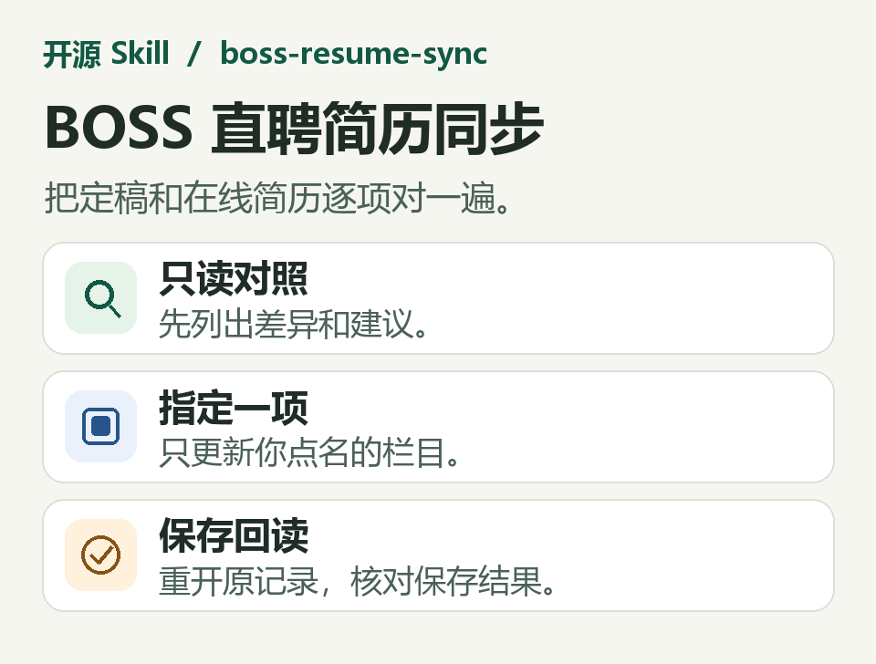
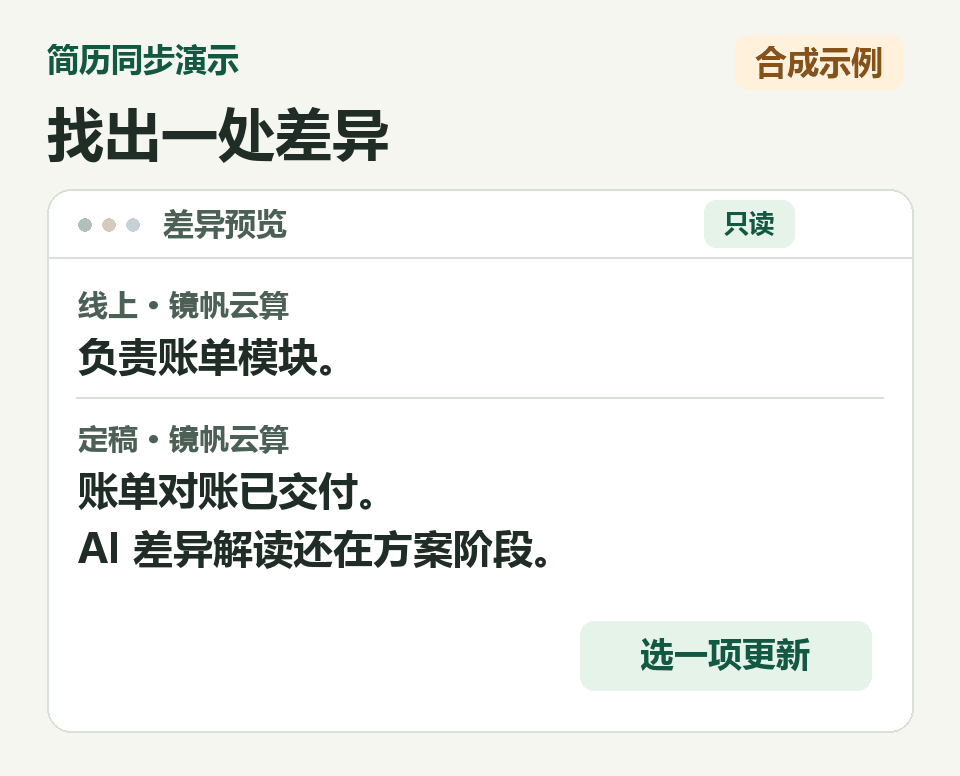
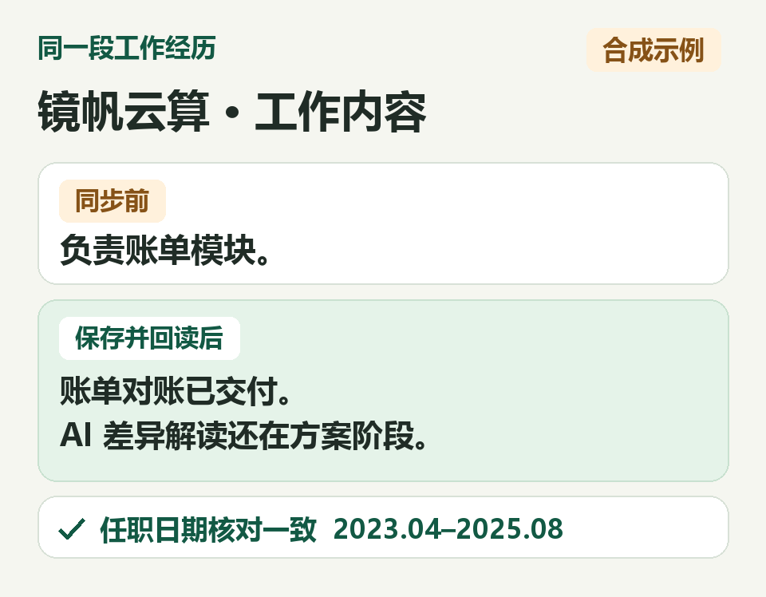

# BOSS 直聘在线简历对照与增量同步

电脑里的简历改好了，BOSS 直聘上那份还有哪里没同步？`boss-resume-sync` 可以对照两份简历，列出差异。你确认后，它可以只更新你点名的栏目或记录，再打开页面核对保存结果。



## 怎么用

把定稿交给能操作浏览器的智能体，打开已登录的 BOSS 直聘网页。第一次可以先让它列出差异：

```text
使用 boss-resume-sync，对照这份定稿和 BOSS 在线简历。列出差异和建议，先别保存。
```

看完差异后，可以点名只改一处：

```text
使用 boss-resume-sync，只更新「镜帆云算」这段工作经历的工作内容。保存后重新打开这一栏核对。
```



## 对照结果

下面是仓库里的[合成样例](examples/synthetic-sync.md)。在线简历只写着「负责账单模块」。定稿补充了已经交付的账单对账流程，并把 AI 差异解读写为方案。只同步这一段工作内容后，重新打开同一条记录，可以逐项核对描述和任职日期。



| 操作 | 能看到什么 |
| --- | --- |
| 只对照 | 线上现值、定稿差异、建议文本，以及需要手动确认的冲突。 |
| 同步指定字段 | 更新授权范围内、匹配关系明确的字段。匹配有疑问或缺必填信息时，列出待确认项。 |
| 保存后回读 | 重新打开实际条目，核对保存后的文字和日期。回执标明已核对和待核对的项目。 |
| 附件 | 按用户指定的文件和操作上传或替换，并核对附件记录。 |

## 一句话安装

把下面这句话发给能访问 GitHub 并安装技能的 Codex 或 WorkBuddy。

```text
请从 https://github.com/ljyoungs/AgentSkills/tree/main/skills/job-search/boss-resume-sync 安装 boss-resume-sync 技能，并确认它已能在当前智能体中调用。
```

## 运行条件

准备一份已经定稿的简历，并在浏览器登录 BOSS 直聘。智能体需要能读取文件和操作网页。用户选择 Chrome CDP 时，优先复用现有可用的 Chrome 会话。网页字段和控件以当前界面为准，遇到登录或验证时由用户在浏览器完成。网页不可访问时，可以先取得按字段整理的录入稿，线上状态仍待核对。

附件需要单独点名，例如：

```text
使用 boss-resume-sync，将《投递版简历.pdf》上传为简历附件。
```

真实简历、页面快照和会话凭据留在用户环境。操作边界见 [SKILL.md](SKILL.md)，浏览器检查与回读见 [BOSS 网页操作参考](references/boss-browser.md)。
